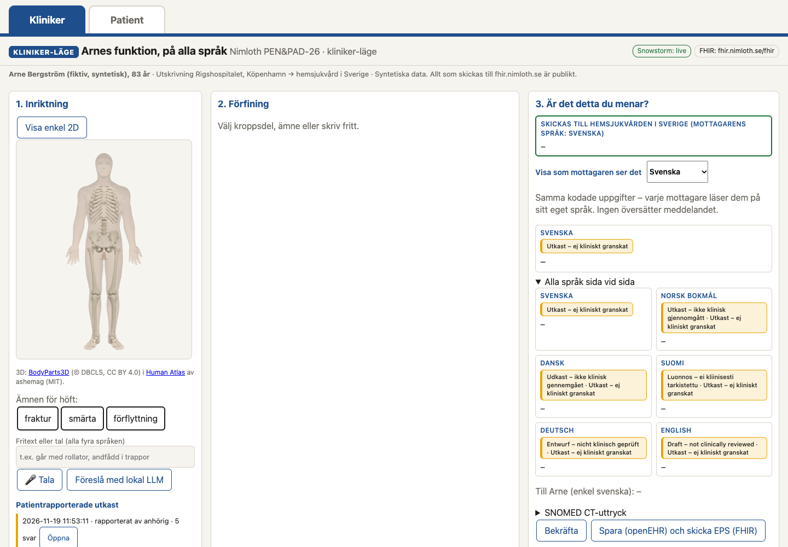
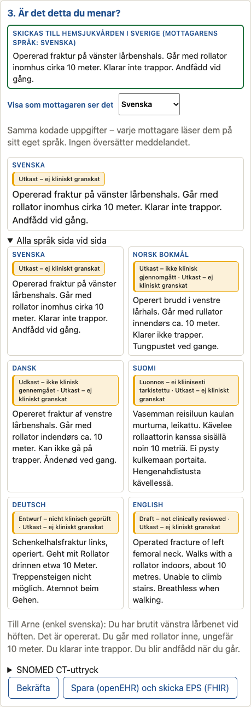
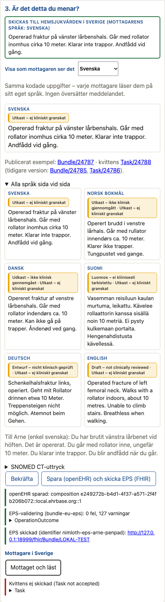
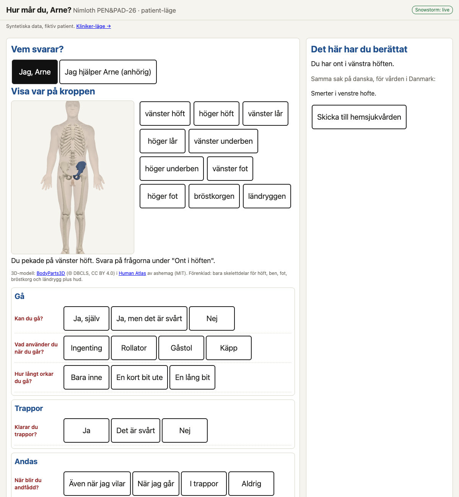

# Arne's function, in any language — PEN&PAD on the Arne scenario
Nordic Hackathon 2026, PEN&PAD-26 bonus track · Nimloth (Anders Carlius)

**Live demo:** https://penpad.nimloth.se (clinician mode) · https://penpad.nimloth.se/patient/ (patient mode). The demo is open until 2026-11-26 (rate-limited); after that it is behind Cloudflare Access again and reviewers are invited by e-mail on request.
**Contact:** TODO(Anders): GitHub handle or contact page

## The gap we aimed at
Arne (83, fictional) breaks his hip on the stairs in Copenhagen and is discharged from a Danish hospital to home care in Sweden. The organisers' medical comments name three gaps: **functional status is missing and nobody notices**, **his son ends up as the interpreter**, and **nobody confirms the hand-over**.

We used the same coded record for both sides of the border:
- **Clinician mode** (discharge, Rigshospitalet) follows the track's three steps. *Orientation:* body map (hip, leg, chest), topic list (transfer, walking, stairs, breathing, pain, wound), or free text / speech. *Refinement:* only follow-ups that make sense, as short questions (fracture → left or right? operated? · walking → aid? how far? · breathing → breathless at rest, walking or stairs?). *Confirmation:* "Is this what you meant?" as a live sentence.
- **Patient mode** (at home in Sweden): plain Swedish and big buttons, plus a **3D body** to point at (where it hurts, where the leg ulcer is). Both modes open on the 3D body; Anders changed this after trying the demo, because the 2D figure felt too crude. For speed, a simple 2D map is one click away ("Visa enkel 2D"), and the topic list stays next to it, so a clinician never has to rotate a model to reach the right form (Rector: "exhaustive is the enemy of the useful"). Both modes use the same component, geometry, FMA→SNOMED table and refinement engine. The body turns slowly (one revolution per ~60 s), stops while the user points at or drags it, resumes after 5 s, and does not move at all under `prefers-reduced-motion`. A list next to the 3D view does the same thing, and replaces it when WebGL or the geometry is missing. Arne answers himself, or his son does it for him. The result is saved as a **draft marked patient-reported**, with "reported by: patient / relative". The home-care nurse opens the draft in clinician mode, refines it and confirms it. We show provenance; we do not try to solve proxy consent.

## Three things worth looking at
1. **The track's three steps in both modes**: orientation, refinement and confirmation.
2. **The sentence generator removes the need for an interpreting son.** One coded entry is rendered deterministically in **Swedish, Norwegian (bokmål), Danish, Finnish, German and English**, plus plain Swedish for Arne. The templates are hand-written and visible (`generator/templates/{sv,sv-enkel,nb,da,fi,de,en}.yaml`). No LLM generates text. A concept without a template is shown as SNOMED term + code + "no translation"; it never fails silently.
   - sv: *Opererad fraktur på vänster lårbenshals. Går med rollator inomhus cirka 10 meter. Klarar inte trappor. Andfådd vid gång.*
   - da: *Opereret fraktur af venstre lårbenshals. Går med rollator indendørs ca. 10 meter. Kan ikke gå på trapper. Åndenød ved gang.*
3. **Functional status lands in an EPS document, with the validation result.** The functional-status findings become `Condition`s in the EPS section *Functional status* (LOINC 47420-5, read from `composition-eu-eps` 1.0.0-ballot, which allows Condition / ClinicalImpression / DocumentReference there). They are added to a copy of the hackathon's Arne EPS bundle; the original is never overwritten. The copy is published as [`Bundle/24785`](https://fhir.nimloth.se/fhir/Bundle/24785) (identifier `nimloth-eps-arne-penpad`) and validates against `bundle-eu-eps` 1.0.0-ballot (matchbox) with **0 errors** (the original fixture has 0 errors / 118 warnings; ours 127, the extra ones are an unavailable eHDSI value set). A **receipt button** ("Mottaget och läst") writes a FHIR `Task` with status *completed* ([`Task/24786`](https://fhir.nimloth.se/fhir/Task/24786), focus `Bundle/24785`): a sent document is not a confirmed hand-over.

## Send codes, render locally
Sending and viewing are two different things. What goes to Swedish home care is the **coded record** (openEHR composition, FHIR resources, the receipt) plus one narrative in the **receiver's** language, Swedish. The receiver decides the language; nobody picks it from a menu. The drop-down **"Visa som mottagaren ser det"** only shows the same coded record rendered in another language, so a Danish, Norwegian, Finnish or German reader sees what *they* would read. Switching it sends nothing and changes nothing (tested: `test/i18n.mjs`). Nobody translates the message; each receiver reads the codes in their own language.

Finnish needs case endings that depend on the body part ("vasemmassa lonkassa", "vasemman reisiluun"), so the Finnish fracture, pain and wound templates are whole sentences per side instead of slots. German avoids the problem by putting the side last, as clinical shorthand does ("Schenkelhalsfraktur links"). All 158 answer combinations of the scenario have a template in every language; a missing one would show SNOMED term + code + "no translation", never silently.

**Native speakers of Norwegian, Danish, Finnish or German: corrections to `generator/templates/` are very welcome as pull requests.**

## Rector's recipe, applied
| Rector (interviews part 2 and 4) | What we built for Arne |
|---|---|
| Separate the concept model, the information model and inference; coordinate, don't merge | SNOMED CT (Snowstorm, Swedish edition) sanctions what can be said; openEHR (EHRbase, template `nimloth_penpad26_symptom.v0`) stores it; FHIR R4 / EPS carries it across the border |
| The concept model *sanctions*: query it, don't invent concepts | Every option is checked at runtime: ECL membership, or the MRCM attribute range (laterality, severity). Unsanctioned options are dropped, or shown dotted when Snowstorm is down |
| Assemble forms from fragments hung on the concept model | `model/arne-scenario.json` holds the fragments (topics, questions, candidate codes); no form rows are hard-coded in the UI |
| Big toggle buttons, a visible "more", no death by a thousand clicks | Big toggles, at most three short questions per topic, one click to undo |
| "Is this what you meant?": show back a processed result, easy to correct | Live sentence (six languages + plain Swedish) and SNOMED CT expression on every click; optional local LLM (on our own box, never the cloud) may only pick among offered values (JSON schema) and its picks are marked until the clinician accepts them |
| Different language for clinicians and patients | `sv` vs `sv-enkel` from the same record; patient mode in plain Swedish |
| Be tolerant of broken parts | Snowstorm down → offline snapshot or unsanctioned + warning; EHRbase down → queued in the browser, "ej sparad"; FHIR down → resource shown, "ej skickad". Tested by pointing each at a wrong URL |
| Show that options exist; let the user turn away at any time | Patient points on a 3D body (BodyParts3D meshes); a hand-written FMA→SNOMED table (`mapping/fma-to-snomed-arne.yaml`, codes confirmed in Snowstorm, laterality as its own field) turns the tap into a site; unknown meshes resolve to the nearest listed region or "unknown place – choose in the list", never a guessed code |
| Cheap cardboard prototypes first | The engine was first built against recorded Snowstorm fixtures (the Clinergy thumb-pain walkthrough is kept as a regression test) |

## The actor test
TODO(Anders): keep the actor-test section from the v0.1 draft (Rector, part 2: was the clinician attending to the patient or to the computer?).

## Honest limitations
- FMA→SNOMED is a hand-written table for this one scenario (hip, thigh, lower leg, foot, chest, lumbar back), not a general mapping. 3D is the default in both modes; we have not run the actor test on whether it slows a clinician down, which is why the 2D map is one click away.
- All language templates are hand-written for this one scenario and marked `review_status: draft_unreviewed`; the view shows "Utkast – ej kliniskt granskat" (translated, with the Swedish text next to it). None has been reviewed by a native speaker yet. They are not a general translator.
- Danish SNOMED CT terms are not loaded in our Snowstorm (only the international and Swedish editions), so the Danish text comes from our templates only.
- Proxy consent for relatives is not solved; we only show provenance.
- openEHR uses a small template generated for the demo (`nimloth_penpad26_symptom.v0`: encounter → story → symptom_sign + anatomical_location, plus exam), pruned from CKM archetypes; a validated functional-status template (e.g. Barthel) would be better.
- Local LLM suggestions run on CPU and take about a minute.
- EHDS requirements apply from 2029–2031; this is a prototype on synthetic data (Arne is fictional).

## 3D model attribution
The 3D body in patient mode uses **BodyParts3D 4.0** (© The Database Center for Life Science, [CC BY 4.0](https://creativecommons.org/licenses/by/4.0/), https://dbarchive.biosciencedbc.jp/en/bodyparts3d/) as packaged in **[Human Atlas](https://github.com/ashemag/human-atlas) by ashemag (MIT)**. We load only 64 skeleton meshes plus the skin (1.6 MB gzip instead of ~33 MB); meshes are copied unchanged. Human Atlas itself is not part of this pull request; we link to it.

## Thanks
To the PEN&PAD revival team for the [Clinergy extractor and notes](https://pen-pad-revival.github.io/docs/clinergy/) and the [thumb-pain walkthrough](https://pen-pad-revival.github.io/docs/clinergy-thumb-pain-demo/), and to the Nordic Hackathon organisers for the Arne scenario. We built on the ideas; we did not copy code or content from the Clinergy installation.

## Screenshots
| | |
|---|---|
|  Orientation: body map + topic list |  Refinement as short questions |
|  Sent in Swedish; the same record viewed in six languages, review status visible |  openEHR saved, EPS validated |
|  Published EPS + "Mottaget och läst" receipt | |
|  Clinician mode (3D by default, mode switcher on top): left hip → pain card, side pre-filled | |
|  Patient mode (relative answering) |  Arne points at his left hip in 3D → "Du har ont i vänstra höften." / "Smerter i venstre hofte." |
