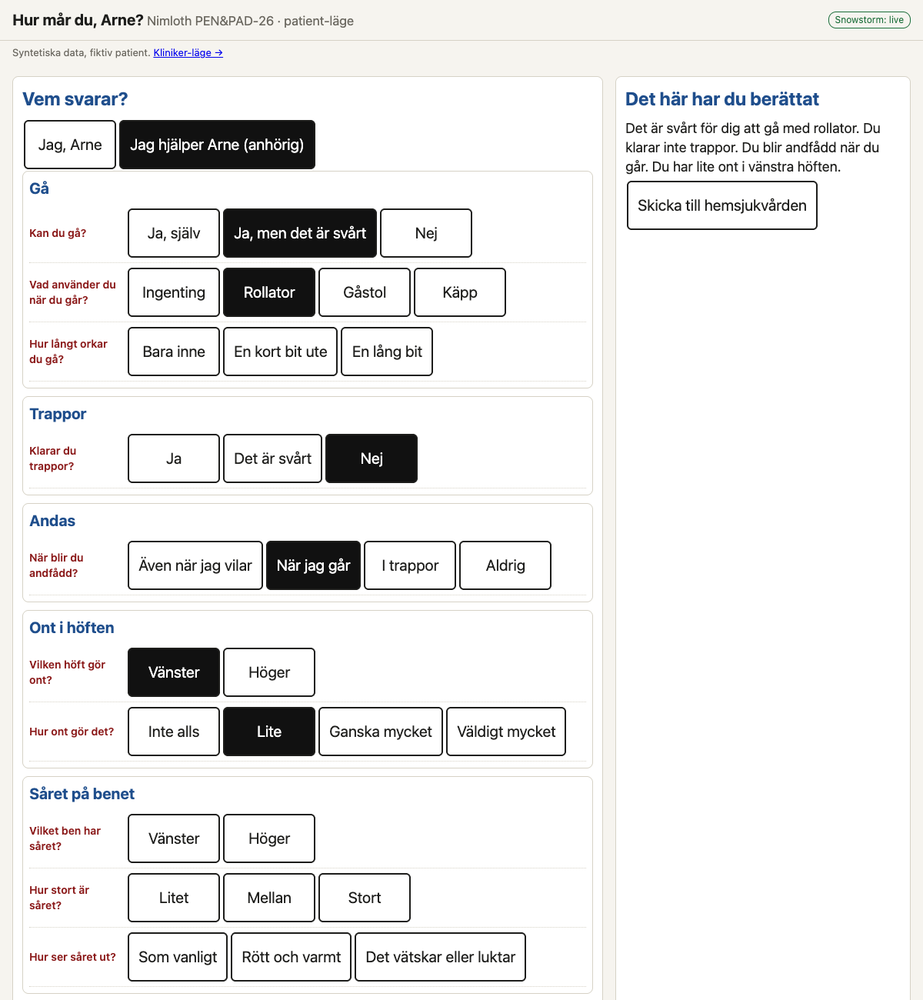

# Arne's function, in any language — PEN&PAD on the Arne scenario
Nordic Hackathon 2026, PEN&PAD-26 bonus track · Nimloth (Anders Carlius)

**Live demo:** https://penpad.nimloth.se (clinician mode) · https://penpad.nimloth.se/patient/ (patient mode)
**Contact:** TODO(Anders): GitHub handle or contact page

## The gap we aimed at
Arne (83, fictional) breaks his hip on the stairs in Copenhagen and is discharged from a Danish hospital to home care in Sweden. The organisers' medical comments name three gaps: **functional status is missing and nobody notices**, **his son ends up as the interpreter**, and **nobody confirms the hand-over**.

We used the same coded record for both sides of the border:
- **Clinician mode** (discharge, Rigshospitalet) follows the track's three steps. *Orientation:* body map (hip, leg, chest), topic list (transfer, walking, stairs, breathing, pain, wound), or free text / speech. *Refinement:* only follow-ups that make sense, as short questions (fracture → left or right? operated? · walking → aid? how far? · breathing → breathless at rest, walking or stairs?). *Confirmation:* "Is this what you meant?" as a live sentence.
- **Patient mode** (at home in Sweden): plain Swedish and big buttons. Arne answers himself, or his son does it for him. The result is saved as a **draft marked patient-reported**, with "reported by: patient / relative". The home-care nurse opens the draft in clinician mode, refines it and confirms it. We show provenance; we do not try to solve proxy consent.

## Three things worth looking at
1. **The track's three steps in both modes**: orientation, refinement and confirmation.
2. **The sentence generator removes the need for an interpreting son.** One coded entry is rendered deterministically in **Danish, Swedish, plain Swedish (for Arne) and English** side by side. The templates are hand-written and visible (`generator/templates/{da,sv,sv-enkel,en}.yaml`). No LLM generates text. A concept without a template is shown as SNOMED term + code + "no translation"; it never fails silently.
   - sv: *Opererad fraktur på vänster lårbenshals. Går med rollator inomhus cirka 10 meter. Klarar inte trappor. Andfådd vid gång.*
   - da: *Opereret fraktur af venstre lårbenshals. Går med rollator indendørs ca. 10 meter. Kan ikke gå på trapper. Åndenød ved gang.*
3. **Functional status lands in an EPS document, with the validation result.** The functional-status findings become `Condition`s in the EPS section *Functional status* (LOINC 47420-5, read from `composition-eu-eps` 1.0.0-ballot, which allows Condition / ClinicalImpression / DocumentReference there). They are added to a copy of the hackathon's Arne EPS bundle; the original is never overwritten. The copy validates against `bundle-eu-eps` 1.0.0-ballot (matchbox) with **0 errors** (the original fixture has 0 errors / 118 warnings; ours 127, the extra ones are an unavailable eHDSI value set). A **receipt button** ("Mottaget och läst") writes a FHIR `Task` with status *completed*: a sent document is not a confirmed hand-over.

## Rector's recipe, applied
| Rector (interviews part 2 and 4) | What we built for Arne |
|---|---|
| Separate the concept model, the information model and inference; coordinate, don't merge | SNOMED CT (Snowstorm, Swedish edition) sanctions what can be said; openEHR (EHRbase, `problem_diagnosis`) stores it; FHIR R4 / EPS carries it across the border |
| The concept model *sanctions*: query it, don't invent concepts | Every option is checked at runtime: ECL membership, or the MRCM attribute range (laterality, severity). Unsanctioned options are dropped, or shown dotted when Snowstorm is down |
| Assemble forms from fragments hung on the concept model | `model/arne-scenario.json` holds the fragments (topics, questions, candidate codes); no form rows are hard-coded in the UI |
| Big toggle buttons, a visible "more", no death by a thousand clicks | Big toggles, at most three short questions per topic, one click to undo |
| "Is this what you meant?": show back a processed result, easy to correct | Live four-language sentence and SNOMED CT expression on every click; optional local LLM (on our own box, never the cloud) may only pick among offered values (JSON schema) and its picks are marked until the clinician accepts them |
| Different language for clinicians and patients | `sv` vs `sv-enkel` from the same record; patient mode in plain Swedish |
| Be tolerant of broken parts | Snowstorm down → offline snapshot or unsanctioned + warning; EHRbase down → queued in the browser, "ej sparad"; FHIR down → resource shown, "ej skickad". Tested by pointing each at a wrong URL |
| Cheap cardboard prototypes first | The engine was first built against recorded Snowstorm fixtures (the Clinergy thumb-pain walkthrough is kept as a regression test) |

## The actor test
TODO(Anders): keep the actor-test section from the v0.1 draft (Rector, part 2: was the clinician attending to the patient or to the computer?).

## Honest limitations
- Danish and plain Swedish are hand-written templates for this one scenario, not a general translator.
- Danish SNOMED CT terms are not loaded in our Snowstorm (only the international and Swedish editions), so the Danish text comes from our templates only.
- Proxy consent for relatives is not solved; we only show provenance.
- openEHR uses the existing `problem_diagnosis` template (one entry per finding); a dedicated functional-status template (e.g. Barthel / symptom_sign) would be better.
- Local LLM suggestions run on CPU and take about a minute.
- EHDS requirements apply from 2029–2031; this is a prototype on synthetic data (Arne is fictional).

## Thanks
To the PEN&PAD revival team for the [Clinergy extractor and notes](https://pen-pad-revival.github.io/docs/clinergy/) and the [thumb-pain walkthrough](https://pen-pad-revival.github.io/docs/clinergy-thumb-pain-demo/), and to the Nordic Hackathon organisers for the Arne scenario. We built on the ideas; we did not copy code or content from the Clinergy installation.

## Screenshots
| | |
|---|---|
|  Orientation: body map + topic list |  Refinement as short questions |
|  One record, four languages |  openEHR saved, EPS validated |
|  Patient mode (relative answering) | |
